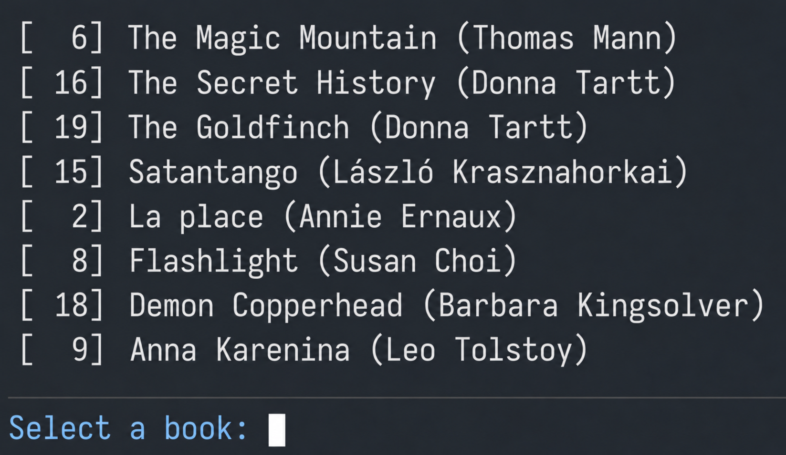

## kindle-highlights

[](https://github.com/FrankKair/kindle-highlights/actions/workflows/ci.yml)

See your Kindle highlights in your terminal.



## Setup

Requires an [opam](https://opam.ocaml.org/doc/Install.html) switch with OCaml 5.0+,
plus [fzf](https://github.com/junegunn/fzf) and `less` on your `PATH`.
From the repository directory:

```sh
opam install . --deps-only --with-test
```

## Usage

Load highlights while the Kindle is connected:

```sh
make load FILE="/path/to/My Clippings.txt"
```

Browse them later without the clippings file:

```sh
make run
```

Each import replaces the saved library, including when the file has no highlights.
Multiline highlights are supported and duplicates are removed when browsing.

Select a book to read its highlights. Use `/` to search, `q` to return to book
selection, and `Esc` in the selector to exit.

Highlights are saved to `~/.local/share/kindle-highlights/library.sexp`, or
`$XDG_DATA_HOME/kindle-highlights/library.sexp` when `XDG_DATA_HOME` is an absolute path.

## Development

```sh
opam install ocamlformat
make test
make fmt
make help
```

Use `make install` to install into the selected opam switch, then run
`opam exec -- kindle_highlights` (or `kindle_highlights` when the switch is on your PATH).

See [PARSER_DESIGN.md](PARSER_DESIGN.md) for parsing rules and performance notes.
